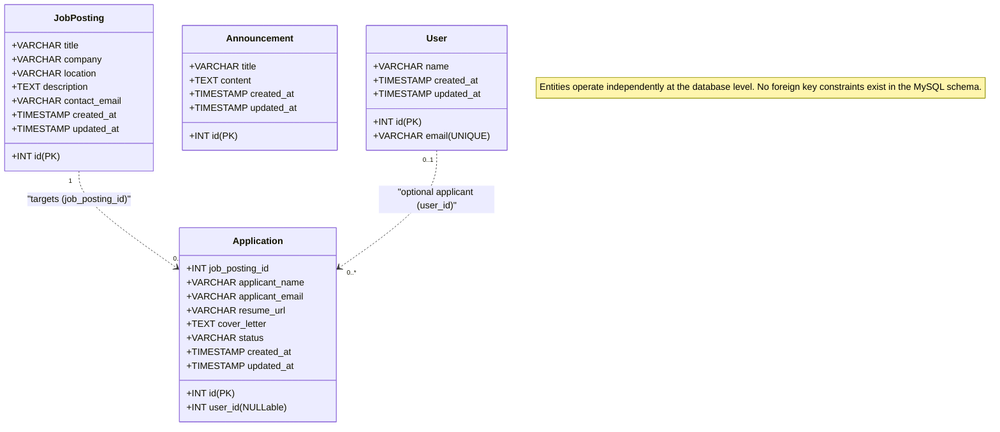

# 📊 Data Design Documentation (DDD)
**Alumni Tracking System**

---

## 1. Executive Summary & Overview

This document provides the authoritative **Data Design Documentation (DDD)** for the **Alumni Tracking System**. It specifies the active data structures, entity models, storage mechanisms, CRUD operations, database migrations, and factory/seed workflows based directly on the actual codebase (`backend/src/models/userModel.js`, `backend/src/models/announcementModel.js`, `backend/src/config/db.js`, migrations, controllers, and views).

> [!NOTE]
> The application has transitioned from early in-memory prototyping to a fully persistent **MySQL 8.0 relational database** architecture. Data is stored in persistent disk storage managed by Docker named volumes, queried asynchronously via connection pooling (`mysql2/promise`), and protected with parameterized queries.

### Related Documentation Cross-Reference
* **System & API Guide:** [`README.md`](file:///c:/Users/akema/Desktop/alumni/README.md)
* **Database Configuration:** [`backend/src/config/db.js`](file:///c:/Users/akema/Desktop/alumni/backend/src/config/db.js)
* **Migration Runner:** [`backend/src/database/migrate.js`](file:///c:/Users/akema/Desktop/alumni/backend/src/database/migrate.js)
* **User Model:** [`backend/src/models/userModel.js`](file:///c:/Users/akema/Desktop/alumni/backend/src/models/userModel.js)
* **Announcement Model:** [`backend/src/models/announcementModel.js`](file:///c:/Users/akema/Desktop/alumni/backend/src/models/announcementModel.js)
* **Docker Compose:** [`docker-compose.yml`](file:///c:/Users/akema/Desktop/alumni/docker-compose.yml)

---

## 2. Active Storage Architecture: MySQL 8.0 Relational Database

All application data is persistently stored in a **MySQL 8.0 database** (`alumni_db`).

```
┌────────────────────────────────────────────────────────────────────────┐
│                        Node.js Runtime Process                         │
│                                                                        │
│   ┌─────────────────────────────┐    ┌─────────────────────────────┐   │
│   │   models/userModel.js       │    │ models/announcementModel.js │   │
│   └──────────────┬──────────────┘    └──────────────┬──────────────┘   │
│                  │                                  │                  │
│                  ▼                                  ▼                  │
│   ┌────────────────────────────────────────────────────────────────┐   │
│   │        backend/src/config/db.js (mysql2 Connection Pool)       │   │
│   └──────────────────────────────┬─────────────────────────────────┘   │
└──────────────────────────────────┼─────────────────────────────────────┘
                                   │ SQL Queries (Parameterized)
                                   ▼
┌────────────────────────────────────────────────────────────────────────┐
│                     MySQL 8.0 Container (alumni-db-1)                  │
│                                                                        │
│  ┌─────────┐   ┌───────────────┐   ┌──────────────┐   ┌────────────┐   │
│  │  users  │   │ announcements │   │ job_postings │   │ migrations │   │
│  └─────────┘   └───────────────┘   └──────────────┘   └────────────┘   │
│                                                                        │
│                   Persistent Named Volume (mysql_data)                 │
└────────────────────────────────────────────────────────────────────────┘
```

### Storage Characteristics:
1. **Connection Pooling:** Managed centrally in [`backend/src/config/db.js`](file:///c:/Users/akema/Desktop/alumni/backend/src/config/db.js) via `mysql2/promise` with automatic host fallback (resolves `db` in Docker network, defaults to `localhost` on host machine).
2. **ACID Guarantees:** InnoDB storage engine provides full transaction support, crash recovery, and row-level locking.
3. **Data Persistence:** All records reside inside the named Docker volume `mysql_data` (`alumni_mysql_data`). Container teardown (`docker compose down`) leaves the volume intact. Data persists seamlessly across restarts.

---

## 3. Verified Entity Specifications

### 3.1. User Entity

The `User` entity models registered alumni, students, and administrators.

* **Model File:** [`backend/src/models/userModel.js`](file:///c:/Users/akema/Desktop/alumni/backend/src/models/userModel.js)
* **Database Table:** `users`
* **Storage Engine:** InnoDB (`utf8mb4_unicode_ci`)
* **Primary Key:** `id` (`INT UNSIGNED AUTO_INCREMENT`)

#### User Field Specifications

| Field Name | MySQL Column Type | Constraints | Description & Behavior |
| :--- | :--- | :--- | :--- |
| `id` | `INT UNSIGNED` | `PRIMARY KEY AUTO_INCREMENT` | Unique numeric identifier for the user. Auto-incremented by MySQL. |
| `name` | `VARCHAR(255)` | `NOT NULL` | Full name of the alumni user. Rendered in views with HTML sanitization (`escapeHtml`). |
| `email` | `VARCHAR(255)` | `NOT NULL UNIQUE` | Contact email address. Enforces uniqueness at database level; controller returns `409 Conflict` on duplicates. |
| `created_at` | `TIMESTAMP` | `DEFAULT CURRENT_TIMESTAMP` | Record creation timestamp automatically stamped by MySQL. |
| `updated_at` | `TIMESTAMP` | `DEFAULT CURRENT_TIMESTAMP ON UPDATE CURRENT_TIMESTAMP` | Last modification timestamp automatically updated on changes. |

#### User Object Example (Runtime JSON)
```json
{
  "id": 1,
  "name": "Esra Şahin",
  "email": "esra.sahin@alumni.edu.tr",
  "created_at": "2026-10-14T15:43:48.000Z",
  "updated_at": "2026-10-14T15:43:48.000Z"
}
```

---

### 3.2. Announcement Entity

The `Announcement` entity represents notices, career events, seminars, and news broadcasted to alumni.

* **Model File:** [`backend/src/models/announcementModel.js`](file:///c:/Users/akema/Desktop/alumni/backend/src/models/announcementModel.js)
* **Database Table:** `announcements`
* **Storage Engine:** InnoDB (`utf8mb4_unicode_ci`)
* **Primary Key:** `id` (`INT UNSIGNED AUTO_INCREMENT`)

#### Announcement Field Specifications

| Field Name | MySQL Column Type | Constraints | Description & Behavior |
| :--- | :--- | :--- | :--- |
| `id` | `INT UNSIGNED` | `PRIMARY KEY AUTO_INCREMENT` | Unique numeric identifier. Auto-incremented by MySQL. |
| `title` | `VARCHAR(255)` | `NOT NULL` | Headline or subject title of the announcement. |
| `content` | `TEXT` | `NOT NULL` | Body text or description. Supports multiline event content. |
| `created_at` | `TIMESTAMP` | `DEFAULT CURRENT_TIMESTAMP` | Creation timestamp. Mapped in model as `createdAt` and `createdDate` for view compatibility. |
| `updated_at` | `TIMESTAMP` | `DEFAULT CURRENT_TIMESTAMP ON UPDATE CURRENT_TIMESTAMP` | Modification timestamp automatically managed by MySQL. |

#### Announcement Object Example (Runtime JSON)
```json
{
  "id": 1,
  "title": "2026 Yıllık Mezunlar Buluşması ve Gala Gecesi",
  "content": "Tüm mezunlarımızı bu yıl 15.sini düzenlediğimiz geleneksel mezunlar buluşması ve plaket törenine davet ediyoruz.",
  "createdAt": "2026-10-14T15:43:48.000Z",
  "createdDate": "2026-10-14T15:43:48.000Z",
  "created_at": "2026-10-14T15:43:48.000Z",
  "updated_at": "2026-10-14T15:43:48.000Z"
}
```

---

### 3.3. Job Posting Entity

The `Job Posting` entity represents career opportunities, job listings, and internship postings shared with students and alumni.

* **Target Database Table:** `job_postings`
* **Storage Engine:** InnoDB (`utf8mb4_unicode_ci`)
* **Primary Key:** `id` (`INT UNSIGNED AUTO_INCREMENT`)

#### Job Posting Field Specifications

| Field Name | MySQL Column Type | Constraints | Description & Behavior |
| :--- | :--- | :--- | :--- |
| `id` | `INT UNSIGNED` | `PRIMARY KEY AUTO_INCREMENT` | Unique numeric identifier for the job posting. Auto-incremented by MySQL. |
| `title` | `VARCHAR(255)` | `NOT NULL` | Headline or position title of the job opening (e.g., "Full Stack Developer"). |
| `company` | `VARCHAR(255)` | `NOT NULL` | Hiring organization or company name. |
| `location` | `VARCHAR(255)` | `NULL` | Work location or arrangement (e.g., "Istanbul / Hybrid", "Remote"). Optional. |
| `description` | `TEXT` | `NOT NULL` | Full role description, responsibilities, qualifications, and application instructions. |
| `contact_email` | `VARCHAR(255)` | `NULL` | Contact or inquiry email address for the position. Optional. |
| `created_at` | `TIMESTAMP` | `DEFAULT CURRENT_TIMESTAMP` | Record creation timestamp automatically stamped by MySQL. |
| `updated_at` | `TIMESTAMP` | `DEFAULT CURRENT_TIMESTAMP ON UPDATE CURRENT_TIMESTAMP` | Last modification timestamp automatically updated on changes. |

#### Design Decisions vs. Assumptions

* **Verified Project Conventions (Design Decisions):**
  * `id`: Uses `INT UNSIGNED AUTO_INCREMENT PRIMARY KEY`, matching `users`, `announcements`, and `migrations`.
  * `created_at` / `updated_at`: Matches the identical MySQL timestamp defaults and automatic update triggers used across `users` and `announcements`.
  * `title` & `description`: Follows the standard column type conventions used in `announcements` (`VARCHAR(255)` for short title, `TEXT` for multiline content).
  * Storage Engine: Standardized on InnoDB (`utf8mb4_unicode_ci`) matching existing database migrations.
* **Domain Assumptions (Distinguished from Existing Code):**
  * `company`: Directly embedded as a `VARCHAR(255) NOT NULL` string because no standalone `companies` table exists in the project.
  * `location` & `contact_email`: Defined as nullable (`NULL`) so postings without fixed physical locations or relying on external application channels remain valid without constraint violations.
  * **Absence of `user_id` Foreign Key:** The existing application code possesses no user authentication, session state, or user roles (`role`) in `users`. Adding a foreign key would be an unverified assumption without explicit project support; the entity is therefore designed as an independent table consistent with `announcements`.

#### Job Posting Object Example (Runtime JSON)
```json
{
  "id": 1,
  "title": "Full Stack Developer",
  "company": "Tech Alumni Corp",
  "location": "Istanbul / Hybrid",
  "description": "Looking for a Full Stack Developer experienced with Node.js and modern web frameworks.",
  "contact_email": "careers@techalumni.com",
  "created_at": "2026-10-21T09:40:00.000Z",
  "updated_at": "2026-10-21T09:40:00.000Z"
}
```

---

### 3.4. Application Entity

The `Application` entity represents job applications submitted by candidates (students or alumni) for specific career opportunities.

* **Target Database Table:** `applications`
* **Storage Engine:** InnoDB (`utf8mb4_unicode_ci`)
* **Primary Key:** `id` (`INT UNSIGNED AUTO_INCREMENT`)

#### Application Field Specifications

| Field Name | MySQL Column Type | Constraints | Description & Behavior |
| :--- | :--- | :--- | :--- |
| `id` | `INT UNSIGNED` | `PRIMARY KEY AUTO_INCREMENT` | Unique numeric identifier for the application. Auto-incremented by MySQL. |
| `job_posting_id` | `INT UNSIGNED` | `NOT NULL` | Target job posting identifier. References `job_postings(id)` at the application level. An application targets exactly one job posting. |
| `user_id` | `INT UNSIGNED` | `NULL` | Optional identifier referencing a registered user (`users(id)`). Nullable to permit guest/unauthenticated candidate submissions without active session dependencies. |
| `applicant_name` | `VARCHAR(255)` | `NOT NULL` | Full name of the applicant. |
| `applicant_email` | `VARCHAR(255)` | `NOT NULL` | Contact email address of the applicant. |
| `resume_url` | `VARCHAR(255)` | `NULL` | Optional URL or link pointing to the applicant's resume, CV, or portfolio. |
| `cover_letter` | `TEXT` | `NULL` | Optional cover letter text, candidate notes, or personal statement. |
| `status` | `VARCHAR(50)` | `NOT NULL DEFAULT 'PENDING'` | Application review status (e.g., `'PENDING'`, `'REVIEWING'`, `'ACCEPTED'`, `'REJECTED'`). |
| `created_at` | `TIMESTAMP` | `DEFAULT CURRENT_TIMESTAMP` | Record creation timestamp automatically stamped by MySQL. |
| `updated_at` | `TIMESTAMP` | `DEFAULT CURRENT_TIMESTAMP ON UPDATE CURRENT_TIMESTAMP` | Last modification timestamp automatically updated on changes. |

#### Design Decisions vs. Assumptions

* **Targeted Job Reference (`job_posting_id`):** Each application is strictly associated with one job posting. In alignment with existing project architectural conventions across `users`, `announcements`, and `job_postings`, **no database-level foreign key constraint** (`FOREIGN KEY ... REFERENCES`) is added to the MySQL schema unless explicitly required. The relationship is validated and maintained at the application and controller level.
* **Optional User Association (`user_id`):** The application currently operates without user authentication, session state, or user roles (`role`) in `users`. To prevent blocking applicants who are not logged in or do not possess a user record, `user_id` is defined as nullable (`NULL`). Direct contact details (`applicant_name` and `applicant_email`) are always stored directly on the application record.
* **Standard Field Conventions:** Column types follow verified existing project conventions (`VARCHAR(255)` for names/emails/URLs, `TEXT` for multiline cover letter, and standard MySQL timestamps).

#### Application Object Example (Runtime JSON)
```json
{
  "id": 1,
  "job_posting_id": 1,
  "user_id": null,
  "applicant_name": "Canan Yılmaz",
  "applicant_email": "canan.yilmaz@alumni.edu.tr",
  "resume_url": "https://storage.alumni.edu.tr/resumes/canan-yilmaz-cv.pdf",
  "cover_letter": "I am eager to apply for the Full Stack Developer role. My background includes Node.js and modern web frameworks.",
  "status": "PENDING",
  "created_at": "2026-10-21T11:25:00.000Z",
  "updated_at": "2026-10-21T11:25:00.000Z"
}
```

---

### 3.5. Migration Metadata Entity

Tracks executed migrations to ensure idempotency.

* **Database Table:** `migrations`
* **Primary Key:** `id` (`INT UNSIGNED AUTO_INCREMENT`)

| Field Name | MySQL Column Type | Constraints | Description |
| :--- | :--- | :--- | :--- |
| `id` | `INT UNSIGNED` | `PRIMARY KEY AUTO_INCREMENT` | Sequence ID. |
| `name` | `VARCHAR(255)` | `NOT NULL UNIQUE` | Unique migration file base name (e.g., `001_create_users_table`). |
| `batch` | `INT UNSIGNED` | `NOT NULL DEFAULT 1` | Execution batch number used for grouped rollbacks. |
| `executed_at`| `TIMESTAMP` | `DEFAULT CURRENT_TIMESTAMP` | Exact timestamp when the migration was applied. |

---

## 4. Entity Relationships

### Relationship Status: **Decoupled Entities with Application-Level References**

Based on the active database implementation and Application architecture:



* **No Database-Level Foreign Keys:** Following existing project conventions across `users`, `announcements`, and `job_postings`, tables do not define database-level `FOREIGN KEY ... REFERENCES` constraints. All entities operate independently at the storage layer.
* **Application-Level Referential Relationships:**
  * **Application $\rightarrow$ JobPosting (1:N):** An `Application` targets exactly one `JobPosting` via the `job_posting_id` reference column. Target existence and cascading workflows are managed at the application and controller layer rather than through database cascade triggers.
  * **Application $\rightarrow$ User (0..1:N):** An `Application` may optionally associate with a registered `User` via the nullable `user_id` column. If the candidate is not logged in or has no user account, `user_id` remains `NULL` while applicant identity is captured directly via `applicant_name` and `applicant_email`.
  * **Announcements:** Completely independent; no relationships to users, job postings, or applications.
* **Relationship Verification & Rationale:**
  * **Verified Code Pattern:** `001_create_users_table.sql`, `002_create_announcements_table.sql`, and `003_create_job_postings_table.sql` all define independent tables without database foreign keys.
  * **Unverified Assumptions Avoided:** Database-level foreign keys are omitted to match existing schema design unless explicitly mandated.

---

## 5. Active Data Access Patterns & CRUD Operations

All data operations are asynchronous (`async/await`) and execute parameterized SQL queries using the connection pool:

| Entity | Operation | Model Function | HTTP Endpoint(s) | SQL Query (Parameterized) |
| :--- | :--- | :--- | :--- | :--- |
| **User** | **Create** | `createUser(userData)` | `POST /users`<br>`POST /api/users` | `INSERT INTO users (name, email) VALUES (?, ?)` |
| **User** | **Read (All)** | `getAllUsers()` | `GET /users`<br>`GET /api/users` | `SELECT id, name, email, created_at, updated_at FROM users ORDER BY id ASC` |
| **User** | **Read (One)** | `getUserById(id)` | `GET /users/:id`<br>`GET /api/users/:id` | `SELECT id, name, email, created_at, updated_at FROM users WHERE id = ? LIMIT 1` |
| **User** | **Update (Full)**| `updateUser(id, data)` | `PUT /users/:id`<br>`PUT /api/users/:id` | `UPDATE users SET name = ?, email = ? WHERE id = ?` |
| **User** | **Update (Part)**| `patchUser(id, partial)` | `PATCH /users/:id`<br>`PATCH /api/users/:id` | `UPDATE users SET name = ?, email = ? WHERE id = ?` *(retains untouched fields)* |
| **User** | **Delete** | `deleteUser(id)` | `DELETE /users/:id`<br>`DELETE /api/users/:id` | `DELETE FROM users WHERE id = ?` |
| **Announcement**| **Create** | `createAnnouncement(data)` | `POST /announcements`<br>`POST /api/announcements` | `INSERT INTO announcements (title, content) VALUES (?, ?)` |
| **Announcement**| **Read (All)** | `getAllAnnouncements()` | `GET /announcements`<br>`GET /api/announcements` | `SELECT id, title, content, created_at, updated_at FROM announcements ORDER BY id ASC` |
| **Announcement**| **Read (One)** | `getAnnouncementById(id)`| `GET /announcements/:id`<br>`GET /api/announcements/:id`| `SELECT id, title, content, created_at, updated_at FROM announcements WHERE id = ? LIMIT 1` |
| **Announcement**| **Update (Full)**| `updateAnnouncement(id, data)`| `PUT /announcements/:id`<br>`PUT /api/announcements/:id`| `UPDATE announcements SET title = ?, content = ? WHERE id = ?` |
| **Announcement**| **Update (Part)**| `patchAnnouncement(id, part)`| `PATCH /announcements/:id`<br>`PATCH /api/announcements/:id`| `UPDATE announcements SET title = ?, content = ? WHERE id = ?` *(retains untouched fields)* |
| **Announcement**| **Delete** | `deleteAnnouncement(id)` | `DELETE /announcements/:id`<br>`DELETE /api/announcements/:id`| `DELETE FROM announcements WHERE id = ?` |
| **Job Posting** | **Create** | `createJobPosting(data)` | `POST /job-postings`<br>`POST /api/job-postings` | `INSERT INTO job_postings (title, company, location, description, contact_email) VALUES (?, ?, ?, ?, ?)` |
| **Job Posting** | **Read (All)** | `getAllJobPostings()` | `GET /job-postings`<br>`GET /api/job-postings` | `SELECT id, title, company, location, description, contact_email, created_at, updated_at FROM job_postings ORDER BY id ASC` |
| **Job Posting** | **Read (One)** | `getJobPostingById(id)` | `GET /job-postings/:id`<br>`GET /api/job-postings/:id` | `SELECT id, title, company, location, description, contact_email, created_at, updated_at FROM job_postings WHERE id = ? LIMIT 1` |
| **Job Posting** | **Update (Full)**| `updateJobPosting(id, data)` | `PUT /job-postings/:id`<br>`PUT /api/job-postings/:id` | `UPDATE job_postings SET title = ?, company = ?, location = ?, description = ?, contact_email = ? WHERE id = ?` |
| **Job Posting** | **Update (Part)**| `patchJobPosting(id, part)` | `PATCH /job-postings/:id`<br>`PATCH /api/job-postings/:id` | `UPDATE job_postings SET title = ?, company = ?, location = ?, description = ?, contact_email = ? WHERE id = ?` *(retains untouched fields)* |
| **Job Posting** | **Delete** | `deleteJobPosting(id)` | `DELETE /job-postings/:id`<br>`DELETE /api/job-postings/:id` | `DELETE FROM job_postings WHERE id = ?` |
| **Application** | **Create** | `createApplication(data)` | `POST /applications`<br>`POST /api/applications`<br>`POST /api/job-postings/:jobId/applications` | `INSERT INTO applications (job_posting_id, user_id, applicant_name, applicant_email, resume_url, cover_letter, status) VALUES (?, ?, ?, ?, ?, ?, ?)` |
| **Application** | **Read (All)** | `getAllApplications()` | `GET /applications`<br>`GET /api/applications` | `SELECT id, job_posting_id, user_id, applicant_name, applicant_email, resume_url, cover_letter, status, created_at, updated_at FROM applications ORDER BY id ASC` |
| **Application** | **Read (By Job)** | `getApplicationsByJobPostingId(jobId)` | `GET /job-postings/:jobId/applications`<br>`GET /api/job-postings/:jobId/applications` | `SELECT id, job_posting_id, user_id, applicant_name, applicant_email, resume_url, cover_letter, status, created_at, updated_at FROM applications WHERE job_posting_id = ? ORDER BY id ASC` |
| **Application** | **Read (One)** | `getApplicationById(id)` | `GET /applications/:id`<br>`GET /api/applications/:id` | `SELECT id, job_posting_id, user_id, applicant_name, applicant_email, resume_url, cover_letter, status, created_at, updated_at FROM applications WHERE id = ? LIMIT 1` |
| **Application** | **Update (Full)**| `updateApplication(id, data)` | `PUT /applications/:id`<br>`PUT /api/applications/:id` | `UPDATE applications SET job_posting_id = ?, user_id = ?, applicant_name = ?, applicant_email = ?, resume_url = ?, cover_letter = ?, status = ? WHERE id = ?` |
| **Application** | **Update (Part)**| `patchApplication(id, part)` | `PATCH /applications/:id`<br>`PATCH /api/applications/:id` | `UPDATE applications SET job_posting_id = ?, ... WHERE id = ?` *(retains untouched fields)* |
| **Application** | **Delete** | `deleteApplication(id)` | `DELETE /applications/:id`<br>`DELETE /api/applications/:id` | `DELETE FROM applications WHERE id = ?` |

---

## 6. Database Migration & Seeding System

### 6.1. Migration Engine (`backend/src/database/migrate.js`)
* Manages DDL migrations in `backend/src/database/migrations/`:
  * `001_create_users_table.sql` & `.js`: Creates `users` table.
  * `002_create_announcements_table.sql` & `.js`: Creates `announcements` table.
  * `003_create_job_postings_table.sql` & `.js`: Creates `job_postings` table.
  * `004_create_applications_table.sql` & `.js`: Creates `applications` table.
* Commands:
  * `npm run migrate`: Applies all pending migrations in alphabetical order within a new batch.
  * `npm run migrate:status`: Displays executed vs. pending migrations table.
  * `npm run migrate:verify`: Inspects and prints table schemas and column types.
  * `npm run migrate:down`: Reverses the most recent migration batch.

### 6.2. Factory & Seeder System (`backend/src/database/`)
* **Factories (`factories/`):**
  * `userFactory.js`: `createOne(overrides)`, `createMany(count, overrides)` with guaranteed unique email addresses (`createMany(n)` never duplicates emails), and `getPredefinedUsers()`.
  * `announcementFactory.js`: `createOne()`, `createMany()`, and `getPredefinedAnnouncements()` producing realistic alumni announcements.
* **Seeders (`seeds/`):**
  * `userSeeder.js`: Inserts 6 alumni users, skipping already registered emails (`[SKIP]`).
  * `announcementSeeder.js`: Inserts 4 alumni announcements, skipping existing titles without adding schema constraints.
  * `seed.js`: Main runner script executed via `npm run seed` or `npm run db:seed`. Idempotent: safe to run multiple times without data duplication.

---

## 7. Docker Persistence & Volume Strategy

Data persistence is guaranteed through the named Docker volume defined in [`docker-compose.yml`](file:///c:/Users/akema/Desktop/alumni/docker-compose.yml):

```yaml
services:
  db:
    image: mysql:8.0
    volumes:
      - mysql_data:/var/lib/mysql
  backend:
    build:
      context: ./backend
      dockerfile: Dockerfile
    ports:
      - "3000:3000"

volumes:
  mysql_data:
```

* **Persistence Verification:** Tested and confirmed via "The Forgetting Test": running `docker compose down` followed by `docker compose up -d` retains all tables, user records, announcement records, and migration history without data loss.
