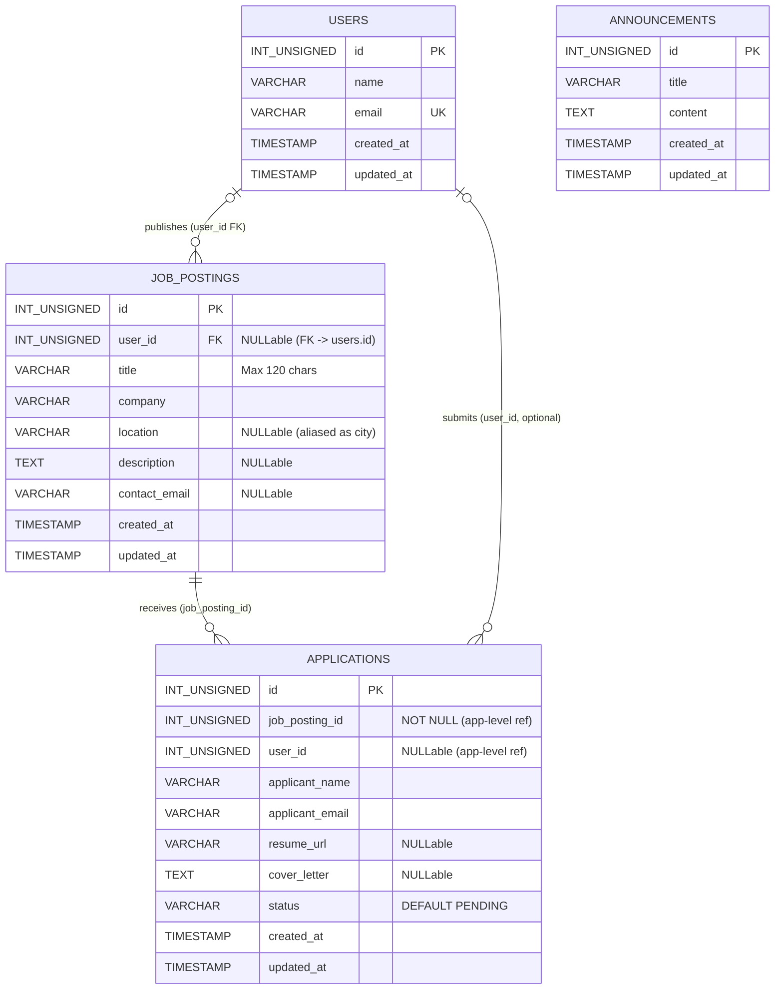

# 📊 Data Design Documentation (DDD)
**Alumni Tracking System**

---

## 1. Executive Summary & Overview

This document provides the authoritative **Data Design Documentation (DDD)** for the **Alumni Tracking System**. It specifies the active data structures, entity models, storage mechanisms, CRUD operations, database migrations, and factory/seed workflows based directly on the actual codebase (`backend/src/models/userModel.js`, `backend/src/models/announcementModel.js`, `backend/src/config/db.js`, migrations, controllers, and views).

> [!NOTE]
> The application has transitioned from early in-memory prototyping to a fully persistent **MySQL 8.0 relational database** architecture. Data is stored in persistent disk storage managed by Docker named volumes, queried asynchronously via connection pooling (`mysql2/promise`), and protected with parameterized queries.

### Related Documentation Cross-Reference
* **System & API Guide:** [`README.md`](file:///c:/Users/akema/Desktop/alumni/README.md)
* **Database Configuration:** [`backend/src/config/db.js`](file:///c:/Users/akema/Desktop/alumni/backend/src/config/db.js)
* **Migration Runner:** [`backend/src/database/migrate.js`](file:///c:/Users/akema/Desktop/alumni/backend/src/database/migrate.js)
* **User Model:** [`backend/src/models/userModel.js`](file:///c:/Users/akema/Desktop/alumni/backend/src/models/userModel.js)
* **Announcement Model:** [`backend/src/models/announcementModel.js`](file:///c:/Users/akema/Desktop/alumni/backend/src/models/announcementModel.js)
* **Docker Compose:** [`docker-compose.yml`](file:///c:/Users/akema/Desktop/alumni/docker-compose.yml)

---

## 2. Active Storage Architecture: MySQL 8.0 Relational Database

All application data is persistently stored in a **MySQL 8.0 database** (`alumni_db`).

```
┌────────────────────────────────────────────────────────────────────────┐
│                        Node.js Runtime Process                         │
│                                                                        │
│   ┌─────────────────────────────┐    ┌─────────────────────────────┐   │
│   │   models/userModel.js       │    │ models/announcementModel.js │   │
│   └──────────────┬──────────────┘    └──────────────┬──────────────┘   │
│                  │                                  │                  │
│                  ▼                                  ▼                  │
│   ┌────────────────────────────────────────────────────────────────┐   │
│   │        backend/src/config/db.js (mysql2 Connection Pool)       │   │
│   └──────────────────────────────┬─────────────────────────────────┘   │
└──────────────────────────────────┼─────────────────────────────────────┘
                                   │ SQL Queries (Parameterized)
                                   ▼
┌────────────────────────────────────────────────────────────────────────┐
│                     MySQL 8.0 Container (alumni-db-1)                  │
│                                                                        │
│  ┌─────────┐   ┌───────────────┐   ┌──────────────┐   ┌────────────┐   │
│  │  users  │   │ announcements │   │ job_postings │   │ migrations │   │
│  └─────────┘   └───────────────┘   └──────────────┘   └────────────┘   │
│                                                                        │
│                   Persistent Named Volume (mysql_data)                 │
└────────────────────────────────────────────────────────────────────────┘
```

### Storage Characteristics:
1. **Connection Pooling:** Managed centrally in [`backend/src/config/db.js`](file:///c:/Users/akema/Desktop/alumni/backend/src/config/db.js) via `mysql2/promise` with automatic host fallback (resolves `db` in Docker network, defaults to `localhost` on host machine).
2. **ACID Guarantees:** InnoDB storage engine provides full transaction support, crash recovery, and row-level locking.
3. **Data Persistence:** All records reside inside the named Docker volume `mysql_data` (`alumni_mysql_data`). Container teardown (`docker compose down`) leaves the volume intact. Data persists seamlessly across restarts.

---

## 3. Verified Entity Specifications

### 3.1. User Entity

#### Purpose
The `User` entity models registered members of the Alumni Tracking System. Conceptually, the system is designed around alumni, current students, and university administrators/faculty (see [Section 4.1](#41-user-roles-implemented-vs-proposed) for current vs. proposed role status). At the data and API layers, `User` records provide identity references for directory management (`/users`, `/api/users`), job posting ownership (`job_postings.user_id`), and optional candidate linking on job applications (`applications.user_id`).

* **Model File:** [`backend/src/models/userModel.js`](file:///c:/Users/akema/Desktop/alumni/backend/src/models/userModel.js)
* **Controllers & Routes:** `userController.js` (`/users`), `apiUserController.js` (`/api/users`), `userRoutes.js`, `apiUserRoutes.js`
* **Views & Seeders:** `userView.js`, `apiUserView.js`, `userJobsView.js`, `userFactory.js`, `userSeeder.js`
* **Database Table:** `users` (`001_create_users_table.sql`)
* **Storage Engine:** InnoDB (`utf8mb4_unicode_ci`)
* **Primary Key:** `id` (`INT UNSIGNED AUTO_INCREMENT`)

#### Existing Attributes & Constraints

| Field Name | MySQL Column Type | Constraints | Description & Behavior |
| :--- | :--- | :--- | :--- |
| `id` | `INT UNSIGNED` | `PRIMARY KEY AUTO_INCREMENT` | Unique numeric identifier for the user. Auto-incremented by MySQL. |
| `name` | `VARCHAR(255)` | `NOT NULL` | Full name of the user. Defaults to `''` in `userModel.createUser` if omitted; rendered in HTML views with XSS sanitization (`escapeHtml`). |
| `email` | `VARCHAR(255)` | `NOT NULL UNIQUE` | Contact email address. Enforces uniqueness at the database level (`UNIQUE`); duplicate inserts or updates trigger `ER_DUP_ENTRY` and return `409 Conflict`. |
| `created_at` | `TIMESTAMP` | `DEFAULT CURRENT_TIMESTAMP` | Record creation timestamp automatically stamped by MySQL. |
| `updated_at` | `TIMESTAMP` | `DEFAULT CURRENT_TIMESTAMP ON UPDATE CURRENT_TIMESTAMP` | Last modification timestamp automatically updated by MySQL on changes. |

> [!NOTE]
> **Schema Scope (Implemented vs. Absent Fields):**
> The active `users` table (`001_create_users_table.sql`) and `userModel.js` contain **only** `id`, `name`, `email`, `created_at`, and `updated_at`. Fields such as `role`, `department`, `graduation_year`, or authentication credentials (`password_hash`) are **not** present in the database schema, model queries, factories, or seeders. While `userView.js` and `apiUserView.js` include defensive template fallbacks (`user.role || user.department`, displaying `"Alumnus / Student Member"` or `"-"` when absent), no role or academic profile columns are persisted or validated yet.

#### Relationships with Other Entities (Implemented)
* **`User` $\rightarrow$ `JobPosting` (`0..1 : N`):** Implemented via `job_postings.user_id` (`INT UNSIGNED DEFAULT NULL`) with a MySQL foreign key constraint (`fk_job_postings_user_id` referencing `users(id)` `ON DELETE SET NULL ON UPDATE CASCADE` from Migration `005`). A user may publish zero or more job postings; deleting a user sets `job_postings.user_id` to `NULL` rather than deleting postings.
* **`User` $\rightarrow$ `Application` (`0..1 : N`):** Implemented at the application level via `applications.user_id` (`INT UNSIGNED DEFAULT NULL`, Migration `004`, without a database-level `FOREIGN KEY` constraint). A user may submit zero or more applications, while `NULL` remains allowed for unauthenticated/guest applications.
* **`Announcement` Independence:** `announcements` currently has no `user_id` or `author_id` column and is not linked to `users`.

#### User Object Example (Runtime JSON)
```json
{
  "id": 1,
  "name": "Esra Şahin",
  "email": "esra.sahin@alumni.edu.tr",
  "created_at": "2026-10-14T15:43:48.000Z",
  "updated_at": "2026-10-14T15:43:48.000Z"
}
```

---

### 3.2. Announcement Entity

The `Announcement` entity represents notices, career events, seminars, and news broadcasted to alumni.

* **Model File:** [`backend/src/models/announcementModel.js`](file:///c:/Users/akema/Desktop/alumni/backend/src/models/announcementModel.js)
* **Database Table:** `announcements`
* **Storage Engine:** InnoDB (`utf8mb4_unicode_ci`)
* **Primary Key:** `id` (`INT UNSIGNED AUTO_INCREMENT`)

#### Announcement Field Specifications

| Field Name | MySQL Column Type | Constraints | Description & Behavior |
| :--- | :--- | :--- | :--- |
| `id` | `INT UNSIGNED` | `PRIMARY KEY AUTO_INCREMENT` | Unique numeric identifier. Auto-incremented by MySQL. |
| `title` | `VARCHAR(255)` | `NOT NULL` | Headline or subject title of the announcement. |
| `content` | `TEXT` | `NOT NULL` | Body text or description. Supports multiline event content. |
| `created_at` | `TIMESTAMP` | `DEFAULT CURRENT_TIMESTAMP` | Creation timestamp. Mapped in model as `createdAt` and `createdDate` for view compatibility. |
| `updated_at` | `TIMESTAMP` | `DEFAULT CURRENT_TIMESTAMP ON UPDATE CURRENT_TIMESTAMP` | Modification timestamp automatically managed by MySQL. |

#### Announcement Object Example (Runtime JSON)
```json
{
  "id": 1,
  "title": "2026 Yıllık Mezunlar Buluşması ve Gala Gecesi",
  "content": "Tüm mezunlarımızı bu yıl 15.sini düzenlediğimiz geleneksel mezunlar buluşması ve plaket törenine davet ediyoruz.",
  "createdAt": "2026-10-14T15:43:48.000Z",
  "createdDate": "2026-10-14T15:43:48.000Z",
  "created_at": "2026-10-14T15:43:48.000Z",
  "updated_at": "2026-10-14T15:43:48.000Z"
}
```

---

### 3.3. Job Posting Entity

The `Job Posting` entity represents career opportunities, job listings, and internship postings shared with students and alumni.

* **Target Database Table:** `job_postings`
* **Storage Engine:** InnoDB (`utf8mb4_unicode_ci`)
* **Primary Key:** `id` (`INT UNSIGNED AUTO_INCREMENT`)

#### Business Rules

JobPosting:
1. title is required.
2. title must have a maximum length of 120 characters.
3. company is required.
4. city is optional.
5. description is optional.

#### Job Posting Field Specifications

| Field Name | MySQL Column Type | Constraints | Description & Behavior |
| :--- | :--- | :--- | :--- |
| `id` | `INT UNSIGNED` | `PRIMARY KEY AUTO_INCREMENT` | Unique numeric identifier for the job posting. Auto-incremented by MySQL. |
| `user_id` | `INT UNSIGNED` | `NULL`, `FOREIGN KEY REFERENCES users(id) ON DELETE SET NULL ON UPDATE CASCADE` | Optional foreign key referencing the user who published the job posting (`users(id)`). Set to `NULL` for legacy or unassigned postings. Enforced when creating via nested route `POST /api/users/:id/jobs`. |
| `title` | `VARCHAR(120)` | `NOT NULL` | Headline or position title of the job opening. Business Rule: **required**, maximum length is **120 characters** (enforced at the database level via Migration `006_update_job_postings_task2_rules.sql`). |
| `company` | `VARCHAR(255)` | `NOT NULL` | Hiring organization or company name. Business Rule: **required**. |
| `location` (`city`) | `VARCHAR(255)` | `NULL` | Work location or city. Business Rule: **city is optional**. Persisted in the database schema under the column name `location`. |
| `description` | `TEXT` | `NULL` | Full role description, responsibilities, and qualifications. Business Rule: **description is optional** (updated from `TEXT NOT NULL` to `TEXT NULL` via Migration `006_update_job_postings_task2_rules.sql`). |
| `contact_email` | `VARCHAR(255)` | `NULL` | Contact or inquiry email address for the position. Optional. |
| `created_at` | `TIMESTAMP` | `DEFAULT CURRENT_TIMESTAMP` | Record creation timestamp automatically stamped by MySQL. |
| `updated_at` | `TIMESTAMP` | `DEFAULT CURRENT_TIMESTAMP ON UPDATE CURRENT_TIMESTAMP` | Last modification timestamp automatically updated on changes. |

#### Design Decisions vs. Assumptions

* **Verified Project Conventions (Design Decisions):**
  * `id`: Uses `INT UNSIGNED AUTO_INCREMENT PRIMARY KEY`, matching `users`, `announcements`, and `migrations`.
  * `created_at` / `updated_at`: Matches the identical MySQL timestamp defaults and automatic update triggers used across `users` and `announcements`.
  * Storage Engine: Standardized on InnoDB (`utf8mb4_unicode_ci`) matching existing database migrations.
  * `user_id` Foreign Key: Added via migration `005_add_user_id_to_job_postings.sql` as a nullable foreign key (`INT UNSIGNED DEFAULT NULL`) referencing `users(id)` (`ON DELETE SET NULL ON UPDATE CASCADE`), allowing legacy postings with `NULL` user_id while linking new postings to creators.
* **Business Rules vs. Current Implementation Notes:**
  * `title`: Business rule requires maximum length of 120 characters; enforced in the database schema as `VARCHAR(120) NOT NULL` via Migration `006_update_job_postings_task2_rules.sql`.
  * `company`: Business rule requires company; enforced as `VARCHAR(255) NOT NULL`.
  * `city`: Business rule specifies city is optional; the active database column is named `location` (`VARCHAR(255) NULL`).
  * `description`: Business rule specifies description is optional; updated in the active database schema (`006_update_job_postings_task2_rules.sql`) to `TEXT NULL`.
  * `location` & `contact_email`: Defined as nullable (`NULL`) so postings without fixed physical locations or relying on external application channels remain valid without constraint violations.

#### Job Posting Object Example (Runtime JSON)
```json
{
  "id": 1,
  "title": "Full Stack Developer",
  "company": "Tech Alumni Corp",
  "location": "Istanbul / Hybrid",
  "description": "Looking for a Full Stack Developer experienced with Node.js and modern web frameworks.",
  "contact_email": "careers@techalumni.com",
  "created_at": "2026-10-21T09:40:00.000Z",
  "updated_at": "2026-10-21T09:40:00.000Z"
}
```

---

### 3.4. Application Entity

The `Application` entity represents job applications submitted by candidates (students or alumni) for specific career opportunities.

* **Target Database Table:** `applications`
* **Storage Engine:** InnoDB (`utf8mb4_unicode_ci`)
* **Primary Key:** `id` (`INT UNSIGNED AUTO_INCREMENT`)

#### Application Field Specifications

| Field Name | MySQL Column Type | Constraints | Description & Behavior |
| :--- | :--- | :--- | :--- |
| `id` | `INT UNSIGNED` | `PRIMARY KEY AUTO_INCREMENT` | Unique numeric identifier for the application. Auto-incremented by MySQL. |
| `job_posting_id` | `INT UNSIGNED` | `NOT NULL` | Target job posting identifier. References `job_postings(id)` at the application level. An application targets exactly one job posting. |
| `user_id` | `INT UNSIGNED` | `NULL` | Optional identifier referencing a registered user (`users(id)`). Nullable to permit guest/unauthenticated candidate submissions without active session dependencies. |
| `applicant_name` | `VARCHAR(255)` | `NOT NULL` | Full name of the applicant. |
| `applicant_email` | `VARCHAR(255)` | `NOT NULL` | Contact email address of the applicant. |
| `resume_url` | `VARCHAR(255)` | `NULL` | Optional URL or link pointing to the applicant's resume, CV, or portfolio. |
| `cover_letter` | `TEXT` | `NULL` | Optional cover letter text, candidate notes, or personal statement. |
| `status` | `VARCHAR(50)` | `NOT NULL DEFAULT 'PENDING'` | Application review status (e.g., `'PENDING'`, `'REVIEWING'`, `'ACCEPTED'`, `'REJECTED'`). |
| `created_at` | `TIMESTAMP` | `DEFAULT CURRENT_TIMESTAMP` | Record creation timestamp automatically stamped by MySQL. |
| `updated_at` | `TIMESTAMP` | `DEFAULT CURRENT_TIMESTAMP ON UPDATE CURRENT_TIMESTAMP` | Last modification timestamp automatically updated on changes. |

#### Design Decisions vs. Assumptions

* **Targeted Job Reference (`job_posting_id`):** Each application is strictly associated with one job posting. In alignment with existing project architectural conventions across `users`, `announcements`, and `job_postings`, **no database-level foreign key constraint** (`FOREIGN KEY ... REFERENCES`) is added to the MySQL schema unless explicitly required. The relationship is validated and maintained at the application and controller level.
* **Optional User Association (`user_id`):** The application currently operates without user authentication, session state, or user roles (`role`) in `users`. To prevent blocking applicants who are not logged in or do not possess a user record, `user_id` is defined as nullable (`NULL`). Direct contact details (`applicant_name` and `applicant_email`) are always stored directly on the application record.
* **Standard Field Conventions:** Column types follow verified existing project conventions (`VARCHAR(255)` for names/emails/URLs, `TEXT` for multiline cover letter, and standard MySQL timestamps).

#### Application Object Example (Runtime JSON)
```json
{
  "id": 1,
  "job_posting_id": 1,
  "user_id": null,
  "applicant_name": "Canan Yılmaz",
  "applicant_email": "canan.yilmaz@alumni.edu.tr",
  "resume_url": "https://storage.alumni.edu.tr/resumes/canan-yilmaz-cv.pdf",
  "cover_letter": "I am eager to apply for the Full Stack Developer role. My background includes Node.js and modern web frameworks.",
  "status": "PENDING",
  "created_at": "2026-10-21T11:25:00.000Z",
  "updated_at": "2026-10-21T11:25:00.000Z"
}
```

---

### 3.5. Migration Metadata Entity

Tracks executed migrations to ensure idempotency.

* **Database Table:** `migrations`
* **Primary Key:** `id` (`INT UNSIGNED AUTO_INCREMENT`)

| Field Name | MySQL Column Type | Constraints | Description |
| :--- | :--- | :--- | :--- |
| `id` | `INT UNSIGNED` | `PRIMARY KEY AUTO_INCREMENT` | Sequence ID. |
| `name` | `VARCHAR(255)` | `NOT NULL UNIQUE` | Unique migration file base name (e.g., `001_create_users_table`). |
| `batch` | `INT UNSIGNED` | `NOT NULL DEFAULT 1` | Execution batch number used for grouped rollbacks. |
| `executed_at`| `TIMESTAMP` | `DEFAULT CURRENT_TIMESTAMP` | Exact timestamp when the migration was applied. |

---

## 4. User Roles, Permissions & Access Control

> [!IMPORTANT]
> **Implementation Status Notice:**
> As of the current codebase, **authentication, authorization, and role-based access control (RBAC) are not yet implemented**. All routes (`/users`, `/announcements`, `/job-postings`, `/applications`, and `/api/*`) are publicly accessible without login, sessions, JWTs, or role checks, and the `users` table does not yet store a `role` or password column. The roles and permissions documented below distinguish strictly between **Current Implemented Behavior** and **[Proposed]** design specifications derived from existing project documentation ([`brand.md`](file:///c:/Users/akema/Desktop/alumni/brand.md), [`aboutView.js`](file:///c:/Users/akema/Desktop/alumni/backend/src/views/aboutView.js), [`userView.js`](file:///c:/Users/akema/Desktop/alumni/backend/src/views/userView.js)).

### 4.1. User Roles (Implemented vs. Proposed)

#### Currently Implemented Roles
* **Implemented Role Definitions:** **None.**
  * `001_create_users_table.sql` defines no `role` column, `ENUM`, or `roles` table.
  * `userModel.js`, `userController.js`, `apiUserController.js`, `userFactory.js`, and `userSeeder.js` contain no role fields, constants, validation rules, or permission checks.
  * `userSeeder.js` seeds 6 `@alumni.edu.tr` users with `{ name, email }` only.
  * `userView.js` and `apiUserView.js` include defensive rendering checks (`user.role || user.department`), falling back to `"Alumnus / Student Member"` in `renderUserDetailPage` or `"-"` in `apiUserView.renderUsersPage` when absent. At runtime, every `User` record has identical capabilities.

#### Proposed Roles *(Not Yet Implemented)*
Based on the stakeholder groups already described in [`brand.md`](file:///c:/Users/akema/Desktop/alumni/brand.md) and [`aboutView.js`](file:///c:/Users/akema/Desktop/alumni/backend/src/views/aboutView.js), the following domain roles are **[Proposed]** for future Authentication and Authorization implementation:

| Role | Status | Represents | Core Responsibilities *(Proposed)* |
| :--- | :--- | :--- | :--- |
| **`alumni`** | **[Proposed]** | University graduates working in industry or academia. | • Maintain their own profile and contact details.<br>• Publish, update, and delete job or internship postings (`job_postings` linked via `user_id`).<br>• Review candidate applications submitted to their own job postings.<br>• Read institutional announcements and optionally apply to other postings. |
| **`student`** | **[Proposed]** | Currently enrolled undergraduate and graduate students. | • Browse active job postings and internship opportunities.<br>• Read departmental and career announcements.<br>• Submit job applications (`applications`) and track or manage their own submitted applications. |
| **`admin`** | **[Proposed]** | University administrators, faculty coordinators, and career center staff. | • View and manage the registered user directory (`/users`, `/api/users`).<br>• Create, update, and delete institutional announcements (`/announcements`, `/api/announcements`).<br>• Moderate job postings across the platform.<br>• Oversee and manage application records and review pipelines (`/applications`). |

> [!NOTE]
> **Unauthenticated / Guest Visitors (Current Baseline & Proposed Restriction):**
> Currently, all endpoints operate without authentication, meaning any caller effectively acts with unrestricted access. Once authentication is introduced, unauthenticated callers (**[Proposed]** `guest`) would be limited to public read-only views or registration/login endpoints (and, only if retained by design, guest application submission where `applications.user_id` is `NULL`).

---

### 4.2. Role-Permission Overview

The matrix below documents **what is currently implemented** alongside the **[Proposed]** role-based permissions for future authorization enforcement.

| Action / Resource | Current Implemented Behavior | `admin` **[Proposed]** | `alumni` **[Proposed]** | `student` **[Proposed]** | `guest` (Unauthenticated) **[Proposed]** |
| :--- | :--- | :--- | :--- | :--- | :--- |
| **View Users** (`GET /users`, `GET /api/users`, `GET /users/:id`) | **Implemented (Open):** Anyone can list and view all users without auth. | **Allowed [Proposed]** (all users) | **Allowed [Proposed]** (directory / own profile) | **Allowed [Proposed]** (directory / own profile) | **Denied [Proposed]** *(401 Unauthorized)* |
| **Manage Users** (`POST/PUT/PATCH/DELETE /users`, `/api/users`) | **Implemented (Open):** Anyone can create, edit, or delete any user. | **Allowed [Proposed]** (full CRUD on all users) | **Own Profile Only [Proposed]** (`PUT/PATCH` own user; cannot delete or edit others) | **Own Profile Only [Proposed]** (`PUT/PATCH` own user; cannot delete or edit others) | **Denied [Proposed]** *(except self-registration if added)* |
| **View Announcements** (`GET /announcements`, `GET /api/announcements`) | **Implemented (Open):** Anyone can view all announcements. | **Allowed [Proposed]** | **Allowed [Proposed]** | **Allowed [Proposed]** | **Allowed [Proposed]** *(public notices)* |
| **Create / Manage Announcements** (`POST/PUT/PATCH/DELETE /announcements`) | **Implemented (Open):** Anyone can create, edit, or delete announcements. | **Allowed [Proposed]** | **Denied [Proposed]** *(403 Forbidden)* | **Denied [Proposed]** *(403 Forbidden)* | **Denied [Proposed]** *(401 Unauthorized)* |
| **View Job Postings** (`GET /job-postings`, `GET /users/:id/jobs`) | **Implemented (Open):** Anyone can view all job postings. | **Allowed [Proposed]** | **Allowed [Proposed]** | **Allowed [Proposed]** | **Allowed [Proposed]** *(or login-gated if required)* |
| **Publish Job Postings** (`POST /job-postings`, `POST /api/users/:id/jobs`) | **Implemented (Open):** Anyone can create postings; nested route assigns `user_id` from URL `:id`. | **Allowed [Proposed]** | **Allowed [Proposed]** (for own account: `user_id = currentUser.id`) | **Denied [Proposed]** *(403 Forbidden)* | **Denied [Proposed]** *(401 Unauthorized)* |
| **Edit / Delete Job Postings** (`PUT/PATCH/DELETE /job-postings/:id`) | **Implemented (Open):** Anyone can modify or delete any job posting. | **Allowed [Proposed]** (any posting) | **Owner Only [Proposed]** (only where `job_postings.user_id = currentUser.id`) | **Denied [Proposed]** *(403 Forbidden)* | **Denied [Proposed]** *(401 Unauthorized)* |
| **Submit Job Application** (`POST /applications`, `POST /job-postings/:id/applications`) | **Implemented (Open):** Anyone can apply; `applications.user_id` is nullable for guest submissions. | **Allowed [Proposed]** | **Allowed [Proposed]** (`user_id = currentUser.id`) | **Allowed [Proposed]** (`user_id = currentUser.id`) | **Conditional / Denied [Proposed]** *(allowed only if guest submissions remain enabled)* |
| **View & Manage Applications / Status** (`GET/PUT/PATCH/DELETE /applications`, status: `PENDING`, `REVIEWING`, `ACCEPTED`, `REJECTED`) | **Implemented (Open):** Anyone can list all applications, view details, change status, or delete. | **Allowed [Proposed]** (view and manage all) | **Scoped [Proposed]** (review/update status for applications targeting own job postings; view/withdraw own applications) | **Own Submissions Only [Proposed]** (view own status / withdraw; cannot change review status) | **Denied [Proposed]** *(401 Unauthorized)* |

---

### 4.3. Authentication vs. Authorization

In the context of the Alumni Tracking System, **Authentication** and **Authorization** address two distinct security concerns:

1. **Authentication (*"Who is the user?"*):**
   * **Concept:** Verifying the identity of a client or user (for example, validating submitted login credentials against stored user credentials and establishing an authenticated identity via a session or signed token such as a JWT).
   * **Project Context:** Once implemented, authentication will identify which `users` record (`users.id`) is making an HTTP request so endpoints no longer rely on unverified URL parameters (such as trusting `:id` in `POST /api/users/:id/jobs` without knowing who the caller is) or leave `applications.user_id` as `NULL` for registered members. Failure to authenticate results in **`401 Unauthorized`**.
   * **Current State:** **Not implemented.** `users` does not have password/credential columns, and there are no login, registration, session, or token-verification middlewares.

2. **Authorization (*"What is the authenticated user allowed to do?"*):**
   * **Concept:** Determining whether an already authenticated user has permission to perform a specific operation on a target resource, based on their assigned **role** (e.g., `admin`, `alumni`, `student`) and/or **resource ownership** (e.g., `job_postings.user_id` or `applications.user_id`).
   * **Project Context:** Authorization enforces rules such as restricting announcement creation (`POST /announcements`) to `admin` users, allowing `alumni` to edit or delete only their own `job_postings`, and restricting application status updates (`PATCH /applications/:id`) to the posting owner (`alumni`) or an `admin`. Failure of an authorization check results in **`403 Forbidden`**.
   * **Current State:** **Not implemented.** While `errorHandlerMiddleware.js` already recognizes HTTP status codes `401` (`Unauthorized`) and `403` (`Forbidden`) if an error with those codes is forwarded, no middleware or controller currently performs authentication or authorization checks.

---

## 5. Domain Relationships

### Relationship Status: **Mixed Foreign-Key and Application-Level References**

Based on the active database migrations (`001` through `006`) and model implementations:



* **Verified Database-Level Foreign Key (`JobPosting` $\rightarrow$ `User`):**
  * **`User` $\rightarrow$ `JobPosting` (`0..1:N`):** Migration `005_add_user_id_to_job_postings.sql` added `job_postings.user_id` (`INT UNSIGNED DEFAULT NULL`) with `CONSTRAINT fk_job_postings_user_id FOREIGN KEY (user_id) REFERENCES users(id) ON DELETE SET NULL ON UPDATE CASCADE`. A user may own zero or more job postings; legacy or unassigned postings have `user_id = NULL`, and deleting a user sets `job_postings.user_id` to `NULL`.
* **Application-Level Referential Relationships (No DB Foreign Keys):**
  * **`JobPosting` $\rightarrow$ `Application` (`1:N`):** An `Application` targets exactly one `JobPosting` via `applications.job_posting_id` (`INT UNSIGNED NOT NULL`, Migration `004`). Target existence is validated at the controller layer (`applicationController.js`, `apiApplicationController.js`) rather than via a MySQL `FOREIGN KEY` constraint.
  * **`User` $\rightarrow$ `Application` (`0..1:N`):** An `Application` may optionally associate with a registered `User` via the nullable `applications.user_id` column (`INT UNSIGNED DEFAULT NULL`, Migration `004`). No database `FOREIGN KEY` constraint is defined; when the candidate is unauthenticated or has no user account, `user_id` remains `NULL` and applicant identity is stored directly in `applicant_name` and `applicant_email`.
* **Independent Entity:**
  * **`Announcement`:** Completely independent (`002_create_announcements_table.sql`); no database or application-level foreign key links `announcements` to `users`, `job_postings`, or `applications`.
* **Proposed Future Extensions *(Not Implemented)*:**
  * **[Proposed]** Adding a `role` attribute (and authentication credential fields) to `users` to support RBAC.
  * **[Proposed]** Optionally associating `announcements` with an authoring `admin` user (e.g., `user_id` / `author_id`) if announcement auditing is introduced later; no such column exists today.

---

## 6. Active Data Access Patterns & CRUD Operations

All data operations are asynchronous (`async/await`) and execute parameterized SQL queries using the connection pool:

| Entity | Operation | Model Function | HTTP Endpoint(s) | SQL Query (Parameterized) |
| :--- | :--- | :--- | :--- | :--- |
| **User** | **Create** | `createUser(userData)` | `POST /users`<br>`POST /api/users` | `INSERT INTO users (name, email) VALUES (?, ?)` |
| **User** | **Read (All)** | `getAllUsers()` | `GET /users`<br>`GET /api/users` | `SELECT id, name, email, created_at, updated_at FROM users ORDER BY id ASC` |
| **User** | **Read (One)** | `getUserById(id)` | `GET /users/:id`<br>`GET /api/users/:id` | `SELECT id, name, email, created_at, updated_at FROM users WHERE id = ? LIMIT 1` |
| **User** | **Update (Full)**| `updateUser(id, data)` | `PUT /users/:id`<br>`PUT /api/users/:id` | `UPDATE users SET name = ?, email = ? WHERE id = ?` |
| **User** | **Update (Part)**| `patchUser(id, partial)` | `PATCH /users/:id`<br>`PATCH /api/users/:id` | `UPDATE users SET name = ?, email = ? WHERE id = ?` *(retains untouched fields)* |
| **User** | **Delete** | `deleteUser(id)` | `DELETE /users/:id`<br>`DELETE /api/users/:id` | `DELETE FROM users WHERE id = ?` |
| **Announcement**| **Create** | `createAnnouncement(data)` | `POST /announcements`<br>`POST /api/announcements` | `INSERT INTO announcements (title, content) VALUES (?, ?)` |
| **Announcement**| **Read (All)** | `getAllAnnouncements()` | `GET /announcements`<br>`GET /api/announcements` | `SELECT id, title, content, created_at, updated_at FROM announcements ORDER BY id ASC` |
| **Announcement**| **Read (One)** | `getAnnouncementById(id)`| `GET /announcements/:id`<br>`GET /api/announcements/:id`| `SELECT id, title, content, created_at, updated_at FROM announcements WHERE id = ? LIMIT 1` |
| **Announcement**| **Update (Full)**| `updateAnnouncement(id, data)`| `PUT /announcements/:id`<br>`PUT /api/announcements/:id`| `UPDATE announcements SET title = ?, content = ? WHERE id = ?` |
| **Announcement**| **Update (Part)**| `patchAnnouncement(id, part)`| `PATCH /announcements/:id`<br>`PATCH /api/announcements/:id`| `UPDATE announcements SET title = ?, content = ? WHERE id = ?` *(retains untouched fields)* |
| **Announcement**| **Delete** | `deleteAnnouncement(id)` | `DELETE /announcements/:id`<br>`DELETE /api/announcements/:id`| `DELETE FROM announcements WHERE id = ?` |
| **Job Posting** | **Create** | `createJobPosting(data)` | `POST /job-postings`<br>`POST /api/job-postings` | `INSERT INTO job_postings (user_id, title, company, location, description, contact_email) VALUES (?, ?, ?, ?, ?, ?)` |
| **Job Posting** | **Create (By User)**| `createJobPosting(data)` | `POST /api/users/:id/jobs` | `INSERT INTO job_postings (user_id, title, company, location, description, contact_email) VALUES (?, ?, ?, ?, ?, ?)` *(user_id URL'den alınır)* |
| **Job Posting** | **Read (All)** | `getAllJobPostings()` | `GET /job-postings`<br>`GET /api/job-postings` | `SELECT id, user_id, title, company, location, description, contact_email, created_at, updated_at FROM job_postings ORDER BY id ASC` |
| **Job Posting** | **Read (One)** | `getJobPostingById(id)` | `GET /job-postings/:id`<br>`GET /api/job-postings/:id` | `SELECT id, user_id, title, company, location, description, contact_email, created_at, updated_at FROM job_postings WHERE id = ? LIMIT 1` |
| **Job Posting** | **Read (By User)** | `getJobPostingsByUserId(userId)` | `GET /api/users/:id/jobs`<br>`GET /users/:id/jobs` | `SELECT id, user_id, title, company, location, description, contact_email, created_at, updated_at FROM job_postings WHERE user_id = ? ORDER BY id ASC` |
| **Job Posting** | **Update (Full)**| `updateJobPosting(id, data)` | `PUT /job-postings/:id`<br>`PUT /api/job-postings/:id` | `UPDATE job_postings SET user_id = ?, title = ?, company = ?, location = ?, description = ?, contact_email = ? WHERE id = ?` |
| **Job Posting** | **Update (Part)**| `patchJobPosting(id, part)` | `PATCH /job-postings/:id`<br>`PATCH /api/job-postings/:id` | `UPDATE job_postings SET user_id = ?, title = ?, company = ?, location = ?, description = ?, contact_email = ? WHERE id = ?` *(retains untouched fields)* |
| **Job Posting** | **Delete** | `deleteJobPosting(id)` | `DELETE /job-postings/:id`<br>`DELETE /api/job-postings/:id` | `DELETE FROM job_postings WHERE id = ?` |
| **Application** | **Create** | `createApplication(data)` | `POST /applications`<br>`POST /api/applications`<br>`POST /api/job-postings/:jobId/applications` | `INSERT INTO applications (job_posting_id, user_id, applicant_name, applicant_email, resume_url, cover_letter, status) VALUES (?, ?, ?, ?, ?, ?, ?)` |
| **Application** | **Read (All)** | `getAllApplications()` | `GET /applications`<br>`GET /api/applications` | `SELECT id, job_posting_id, user_id, applicant_name, applicant_email, resume_url, cover_letter, status, created_at, updated_at FROM applications ORDER BY id ASC` |
| **Application** | **Read (By Job)** | `getApplicationsByJobPostingId(jobId)` | `GET /job-postings/:jobId/applications`<br>`GET /api/job-postings/:jobId/applications` | `SELECT id, job_posting_id, user_id, applicant_name, applicant_email, resume_url, cover_letter, status, created_at, updated_at FROM applications WHERE job_posting_id = ? ORDER BY id ASC` |
| **Application** | **Read (One)** | `getApplicationById(id)` | `GET /applications/:id`<br>`GET /api/applications/:id` | `SELECT id, job_posting_id, user_id, applicant_name, applicant_email, resume_url, cover_letter, status, created_at, updated_at FROM applications WHERE id = ? LIMIT 1` |
| **Application** | **Update (Full)**| `updateApplication(id, data)` | `PUT /applications/:id`<br>`PUT /api/applications/:id` | `UPDATE applications SET job_posting_id = ?, user_id = ?, applicant_name = ?, applicant_email = ?, resume_url = ?, cover_letter = ?, status = ? WHERE id = ?` |
| **Application** | **Update (Part)**| `patchApplication(id, part)` | `PATCH /applications/:id`<br>`PATCH /api/applications/:id` | `UPDATE applications SET job_posting_id = ?, ... WHERE id = ?` *(retains untouched fields)* |
| **Application** | **Delete** | `deleteApplication(id)` | `DELETE /applications/:id`<br>`DELETE /api/applications/:id` | `DELETE FROM applications WHERE id = ?` |

---

## 7. Database Migration & Seeding System

### 7.1. Migration Engine (`backend/src/database/migrate.js`)
* Manages DDL migrations in `backend/src/database/migrations/`:
  * `001_create_users_table.sql` & `.js`: Creates `users` table.
  * `002_create_announcements_table.sql` & `.js`: Creates `announcements` table.
  * `003_create_job_postings_table.sql` & `.js`: Creates `job_postings` table.
  * `004_create_applications_table.sql` & `.js`: Creates `applications` table.
  * `005_add_user_id_to_job_postings.sql` & `.js`: Adds `user_id` with foreign key constraint referencing `users(id)` (`ON DELETE SET NULL ON UPDATE CASCADE`).
  * `006_update_job_postings_task2_rules.sql` & `.js`: Modifies `job_postings` to enforce `title VARCHAR(120) NOT NULL` and allow `description TEXT NULL`.
  * `009_add_auth_role_to_users.sql` & `.js`: Adds `auth_role VARCHAR(50) NOT NULL DEFAULT 'user'` AFTER `role` on `users` (decoupling authorization from academic account types `'student'`/`'alumni'`) plus generated `single_admin_guard` with `UNIQUE KEY uq_users_single_admin` so at most one administrator account can exist.
* **Admin Promotion Script (`backend/src/database/promoteAdmin.js`):** Promotes an explicitly specified existing registered user (with `password_hash`) to `auth_role = 'admin'` inside a transaction with row locking via `npm run admin:promote -- <email>`, blocking any second admin and never modifying other user accounts.
* **Transactional Integrity Guards:**
  * `userModel.updateUserAdmin` & `safeDeleteUserById` (`deleteUser` / `deleteUserAdmin`) lock rows with `FOR UPDATE` to block demoting or deleting the sole admin and detach dependent `applications` (`user_id = NULL`) on non-admin deletion.
  * `jobPostingModel.deleteJobPosting` runs inside a transaction with `FOR UPDATE` locking and throws `JOB_HAS_APPLICATIONS` (`409 Conflict`) if any applications reference the job posting.
* Commands:
  * `npm run migrate`: Applies all pending migrations in alphabetical order within a new batch.
  * `npm run migrate:status`: Displays executed vs. pending migrations table.
  * `npm run migrate:verify`: Inspects and prints table schemas and column types.
  * `npm run migrate:down`: Reverses the most recent migration batch.

### 7.2. Factory & Seeder System (`backend/src/database/`)
* **Factories (`factories/`):**
  * `userFactory.js`: `createOne(overrides)`, `createMany(count, overrides)` with guaranteed unique email addresses (`createMany(n)` never duplicates emails), and `getPredefinedUsers()`.
  * `announcementFactory.js`: `createOne()`, `createMany()`, and `getPredefinedAnnouncements()` producing realistic alumni announcements.
  * `jobPostingFactory.js`: `createOne(overrides)`, `createMany(count, overrides)`, and `getPredefinedJobPostings()` producing 5 realistic sample job postings.
* **Seeders (`seeds/`):**
  * `userSeeder.js`: Inserts 6 alumni users, skipping already registered emails (`[SKIP]`).
  * `announcementSeeder.js`: Inserts 4 alumni announcements, skipping existing titles without adding schema constraints.
  * `jobPostingSeeder.js`: Inserts 5 predefined job postings, skipping records with matching `title` and `company` (`[SKIP]`) without adding schema constraints.
  * `seed.js`: Main runner script executed via `npm run seed` or `npm run db:seed`. Idempotent: safe to run multiple times without data duplication.

---

## 8. Docker Persistence & Volume Strategy

Data persistence is guaranteed through the named Docker volume defined in [`docker-compose.yml`](file:///c:/Users/akema/Desktop/alumni/docker-compose.yml):

```yaml
services:
  db:
    image: mysql:8.0
    volumes:
      - mysql_data:/var/lib/mysql
  backend:
    build:
      context: ./backend
      dockerfile: Dockerfile
    ports:
      - "3000:3000"

volumes:
  mysql_data:
```

* **Persistence Verification:** Tested and confirmed via "The Forgetting Test": running `docker compose down` followed by `docker compose up -d` retains all tables, user records, announcement records, and migration history without data loss.
