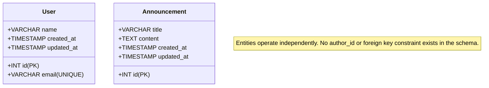

# 📊 Data Design Documentation (DDD)
**Alumni Tracking System**

---

## 1. Executive Summary & Overview

This document provides the authoritative **Data Design Documentation (DDD)** for the **Alumni Tracking System**. It specifies the active data structures, entity models, storage mechanisms, CRUD operations, database migrations, and factory/seed workflows based directly on the actual codebase (`backend/src/models/userModel.js`, `backend/src/models/announcementModel.js`, `backend/src/config/db.js`, migrations, controllers, and views).

> [!NOTE]
> The application has transitioned from early in-memory prototyping to a fully persistent **MySQL 8.0 relational database** architecture. Data is stored in persistent disk storage managed by Docker named volumes, queried asynchronously via connection pooling (`mysql2/promise`), and protected with parameterized queries.

### Related Documentation Cross-Reference
* **System & API Guide:** [`README.md`](file:///c:/Users/akema/Desktop/alumni/README.md)
* **Database Configuration:** [`backend/src/config/db.js`](file:///c:/Users/akema/Desktop/alumni/backend/src/config/db.js)
* **Migration Runner:** [`backend/src/database/migrate.js`](file:///c:/Users/akema/Desktop/alumni/backend/src/database/migrate.js)
* **User Model:** [`backend/src/models/userModel.js`](file:///c:/Users/akema/Desktop/alumni/backend/src/models/userModel.js)
* **Announcement Model:** [`backend/src/models/announcementModel.js`](file:///c:/Users/akema/Desktop/alumni/backend/src/models/announcementModel.js)
* **Docker Compose:** [`docker-compose.yml`](file:///c:/Users/akema/Desktop/alumni/docker-compose.yml)

---

## 2. Active Storage Architecture: MySQL 8.0 Relational Database

All application data is persistently stored in a **MySQL 8.0 database** (`alumni_db`).

```
┌────────────────────────────────────────────────────────────────────────┐
│                        Node.js Runtime Process                         │
│                                                                        │
│   ┌─────────────────────────────┐    ┌─────────────────────────────┐   │
│   │   models/userModel.js       │    │ models/announcementModel.js │   │
│   └──────────────┬──────────────┘    └──────────────┬──────────────┘   │
│                  │                                  │                  │
│                  ▼                                  ▼                  │
│   ┌────────────────────────────────────────────────────────────────┐   │
│   │        backend/src/config/db.js (mysql2 Connection Pool)       │   │
│   └──────────────────────────────┬─────────────────────────────────┘   │
└──────────────────────────────────┼─────────────────────────────────────┘
                                   │ SQL Queries (Parameterized)
                                   ▼
┌────────────────────────────────────────────────────────────────────────┐
│                     MySQL 8.0 Container (alumni-db-1)                  │
│                                                                        │
│   ┌───────────────────┐  ┌─────────────────────────┐  ┌────────────┐   │
│   │       users       │  │      announcements      │  │ migrations │   │
│   └───────────────────┘  └─────────────────────────┘  └────────────┘   │
│                                                                        │
│                   Persistent Named Volume (mysql_data)                 │
└────────────────────────────────────────────────────────────────────────┘
```

### Storage Characteristics:
1. **Connection Pooling:** Managed centrally in [`backend/src/config/db.js`](file:///c:/Users/akema/Desktop/alumni/backend/src/config/db.js) via `mysql2/promise` with automatic host fallback (resolves `db` in Docker network, defaults to `localhost` on host machine).
2. **ACID Guarantees:** InnoDB storage engine provides full transaction support, crash recovery, and row-level locking.
3. **Data Persistence:** All records reside inside the named Docker volume `mysql_data` (`alumni_mysql_data`). Container teardown (`docker compose down`) leaves the volume intact. Data persists seamlessly across restarts.

---

## 3. Verified Entity Specifications

### 3.1. User Entity

The `User` entity models registered alumni, students, and administrators.

* **Model File:** [`backend/src/models/userModel.js`](file:///c:/Users/akema/Desktop/alumni/backend/src/models/userModel.js)
* **Database Table:** `users`
* **Storage Engine:** InnoDB (`utf8mb4_unicode_ci`)
* **Primary Key:** `id` (`INT UNSIGNED AUTO_INCREMENT`)

#### User Field Specifications

| Field Name | MySQL Column Type | Constraints | Description & Behavior |
| :--- | :--- | :--- | :--- |
| `id` | `INT UNSIGNED` | `PRIMARY KEY AUTO_INCREMENT` | Unique numeric identifier for the user. Auto-incremented by MySQL. |
| `name` | `VARCHAR(255)` | `NOT NULL` | Full name of the alumni user. Rendered in views with HTML sanitization (`escapeHtml`). |
| `email` | `VARCHAR(255)` | `NOT NULL UNIQUE` | Contact email address. Enforces uniqueness at database level; controller returns `409 Conflict` on duplicates. |
| `created_at` | `TIMESTAMP` | `DEFAULT CURRENT_TIMESTAMP` | Record creation timestamp automatically stamped by MySQL. |
| `updated_at` | `TIMESTAMP` | `DEFAULT CURRENT_TIMESTAMP ON UPDATE CURRENT_TIMESTAMP` | Last modification timestamp automatically updated on changes. |

#### User Object Example (Runtime JSON)
```json
{
  "id": 1,
  "name": "Esra Şahin",
  "email": "esra.sahin@alumni.edu.tr",
  "created_at": "2026-10-14T15:43:48.000Z",
  "updated_at": "2026-10-14T15:43:48.000Z"
}
```

---

### 3.2. Announcement Entity

The `Announcement` entity represents notices, career events, seminars, and news broadcasted to alumni.

* **Model File:** [`backend/src/models/announcementModel.js`](file:///c:/Users/akema/Desktop/alumni/backend/src/models/announcementModel.js)
* **Database Table:** `announcements`
* **Storage Engine:** InnoDB (`utf8mb4_unicode_ci`)
* **Primary Key:** `id` (`INT UNSIGNED AUTO_INCREMENT`)

#### Announcement Field Specifications

| Field Name | MySQL Column Type | Constraints | Description & Behavior |
| :--- | :--- | :--- | :--- |
| `id` | `INT UNSIGNED` | `PRIMARY KEY AUTO_INCREMENT` | Unique numeric identifier. Auto-incremented by MySQL. |
| `title` | `VARCHAR(255)` | `NOT NULL` | Headline or subject title of the announcement. |
| `content` | `TEXT` | `NOT NULL` | Body text or description. Supports multiline event content. |
| `created_at` | `TIMESTAMP` | `DEFAULT CURRENT_TIMESTAMP` | Creation timestamp. Mapped in model as `createdAt` and `createdDate` for view compatibility. |
| `updated_at` | `TIMESTAMP` | `DEFAULT CURRENT_TIMESTAMP ON UPDATE CURRENT_TIMESTAMP` | Modification timestamp automatically managed by MySQL. |

#### Announcement Object Example (Runtime JSON)
```json
{
  "id": 1,
  "title": "2026 Yıllık Mezunlar Buluşması ve Gala Gecesi",
  "content": "Tüm mezunlarımızı bu yıl 15.sini düzenlediğimiz geleneksel mezunlar buluşması ve plaket törenine davet ediyoruz.",
  "createdAt": "2026-10-14T15:43:48.000Z",
  "createdDate": "2026-10-14T15:43:48.000Z",
  "created_at": "2026-10-14T15:43:48.000Z",
  "updated_at": "2026-10-14T15:43:48.000Z"
}
```

---

### 3.3. Migration Metadata Entity

Tracks executed migrations to ensure idempotency.

* **Database Table:** `migrations`
* **Primary Key:** `id` (`INT UNSIGNED AUTO_INCREMENT`)

| Field Name | MySQL Column Type | Constraints | Description |
| :--- | :--- | :--- | :--- |
| `id` | `INT UNSIGNED` | `PRIMARY KEY AUTO_INCREMENT` | Sequence ID. |
| `name` | `VARCHAR(255)` | `NOT NULL UNIQUE` | Unique migration file base name (e.g., `001_create_users_table`). |
| `batch` | `INT UNSIGNED` | `NOT NULL DEFAULT 1` | Execution batch number used for grouped rollbacks. |
| `executed_at`| `TIMESTAMP` | `DEFAULT CURRENT_TIMESTAMP` | Exact timestamp when the migration was applied. |

---

## 4. Entity Relationships

### Relationship Status: **Independent Entities (No Foreign Key)**

Based on the actual project implementation:



* **No Foreign Key:** The `announcements` table does **not** contain an `author_id` or user reference.
* **Decoupled Operations:** Both entities are created, updated, queried, and deleted entirely independently.

---

## 5. Active Data Access Patterns & CRUD Operations

All data operations are asynchronous (`async/await`) and execute parameterized SQL queries using the connection pool:

| Entity | Operation | Model Function | HTTP Endpoint(s) | SQL Query (Parameterized) |
| :--- | :--- | :--- | :--- | :--- |
| **User** | **Create** | `createUser(userData)` | `POST /users`<br>`POST /api/users` | `INSERT INTO users (name, email) VALUES (?, ?)` |
| **User** | **Read (All)** | `getAllUsers()` | `GET /users`<br>`GET /api/users` | `SELECT id, name, email, created_at, updated_at FROM users ORDER BY id ASC` |
| **User** | **Read (One)** | `getUserById(id)` | `GET /users/:id`<br>`GET /api/users/:id` | `SELECT id, name, email, created_at, updated_at FROM users WHERE id = ? LIMIT 1` |
| **User** | **Update (Full)**| `updateUser(id, data)` | `PUT /users/:id`<br>`PUT /api/users/:id` | `UPDATE users SET name = ?, email = ? WHERE id = ?` |
| **User** | **Update (Part)**| `patchUser(id, partial)` | `PATCH /users/:id`<br>`PATCH /api/users/:id` | `UPDATE users SET name = ?, email = ? WHERE id = ?` *(retains untouched fields)* |
| **User** | **Delete** | `deleteUser(id)` | `DELETE /users/:id`<br>`DELETE /api/users/:id` | `DELETE FROM users WHERE id = ?` |
| **Announcement**| **Create** | `createAnnouncement(data)` | `POST /announcements`<br>`POST /api/announcements` | `INSERT INTO announcements (title, content) VALUES (?, ?)` |
| **Announcement**| **Read (All)** | `getAllAnnouncements()` | `GET /announcements`<br>`GET /api/announcements` | `SELECT id, title, content, created_at, updated_at FROM announcements ORDER BY id ASC` |
| **Announcement**| **Read (One)** | `getAnnouncementById(id)`| `GET /announcements/:id`<br>`GET /api/announcements/:id`| `SELECT id, title, content, created_at, updated_at FROM announcements WHERE id = ? LIMIT 1` |
| **Announcement**| **Update (Full)**| `updateAnnouncement(id, data)`| `PUT /announcements/:id`<br>`PUT /api/announcements/:id`| `UPDATE announcements SET title = ?, content = ? WHERE id = ?` |
| **Announcement**| **Update (Part)**| `patchAnnouncement(id, part)`| `PATCH /announcements/:id`<br>`PATCH /api/announcements/:id`| `UPDATE announcements SET title = ?, content = ? WHERE id = ?` *(retains untouched fields)* |
| **Announcement**| **Delete** | `deleteAnnouncement(id)` | `DELETE /announcements/:id`<br>`DELETE /api/announcements/:id`| `DELETE FROM announcements WHERE id = ?` |

---

## 6. Database Migration & Seeding System

### 6.1. Migration Engine (`backend/src/database/migrate.js`)
* Manages DDL migrations in `backend/src/database/migrations/`:
  * `001_create_users_table.sql` & `.js`: Creates `users` table.
  * `002_create_announcements_table.sql` & `.js`: Creates `announcements` table.
* Commands:
  * `npm run migrate`: Applies all pending migrations in alphabetical order within a new batch.
  * `npm run migrate:status`: Displays executed vs. pending migrations table.
  * `npm run migrate:verify`: Inspects and prints table schemas and column types.
  * `npm run migrate:down`: Reverses the most recent migration batch.

### 6.2. Factory & Seeder System (`backend/src/database/`)
* **Factories (`factories/`):**
  * `userFactory.js`: `createOne(overrides)`, `createMany(count, overrides)` with guaranteed unique email addresses (`createMany(n)` never duplicates emails), and `getPredefinedUsers()`.
  * `announcementFactory.js`: `createOne()`, `createMany()`, and `getPredefinedAnnouncements()` producing realistic alumni announcements.
* **Seeders (`seeds/`):**
  * `userSeeder.js`: Inserts 6 alumni users, skipping already registered emails (`[SKIP]`).
  * `announcementSeeder.js`: Inserts 4 alumni announcements, skipping existing titles without adding schema constraints.
  * `seed.js`: Main runner script executed via `npm run seed` or `npm run db:seed`. Idempotent: safe to run multiple times without data duplication.

---

## 7. Docker Persistence & Volume Strategy

Data persistence is guaranteed through the named Docker volume defined in [`docker-compose.yml`](file:///c:/Users/akema/Desktop/alumni/docker-compose.yml):

```yaml
services:
  db:
    image: mysql:8.0
    volumes:
      - mysql_data:/var/lib/mysql
  backend:
    build:
      context: ./backend
      dockerfile: Dockerfile
    ports:
      - "3000:3000"

volumes:
  mysql_data:
```

* **Persistence Verification:** Tested and confirmed via "The Forgetting Test": running `docker compose down` followed by `docker compose up -d` retains all tables, user records, announcement records, and migration history without data loss.
